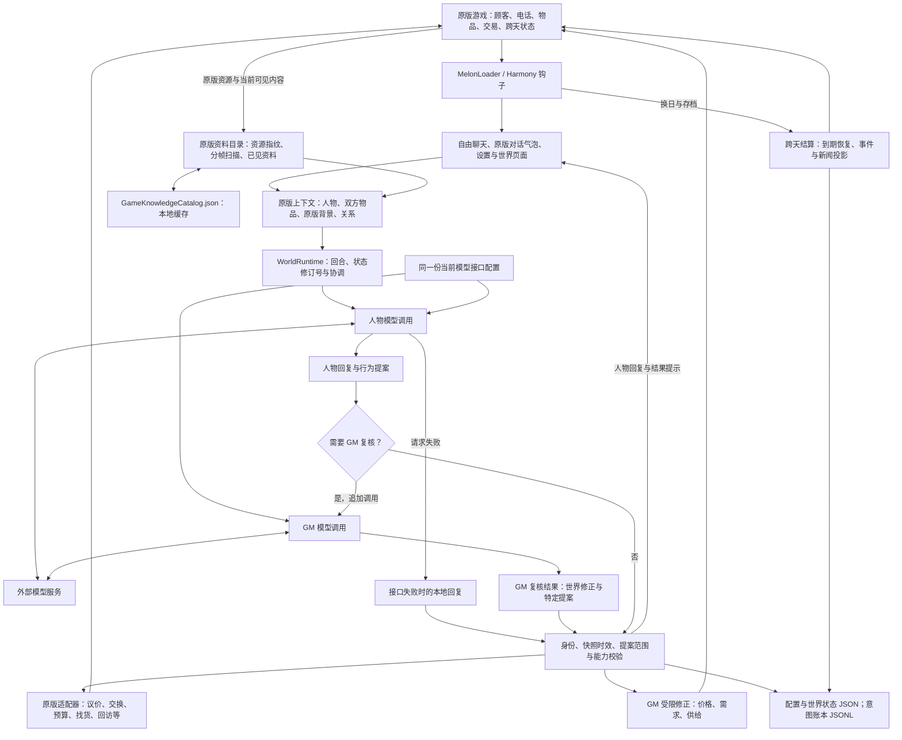

# 当铺世界 Mod 架构图

适用版本：Mod 0.2.2 / Probably Stolen Demo 0.46D。本图描述当前代码的运行路径，不是未来功能规划。

人物回复与 GM 审核是两种职责，但使用同一份当前接口配置；GM 仅在符合触发条件时串行调用。模型只输出候选回复和提案，不能直接调用原版函数或任意改写字段。实际改变由运行时核对当前人物、交易现场、执行器白名单和快照时效后完成。请求失败或人物身份冲突会转入本地回复；过期回合的文字可以显示，但其副作用会被移除。

主要实现位置：

- `src/AIWorldPawnshopMod.cs`、`src/GamePatches.cs`：加载和原版事件入口。
- `src/UI/ChatUiController.cs`、`src/Runtime/NativeConversationContextBuilder.cs`：聊天交互和当前游戏状态快照。
- `src/Runtime/GameKnowledgeCatalog.cs`：原版资源变更检测、本地缓存、分帧物品扫描与可见资料检索。
- `src/Runtime/WorldRuntime.cs`、`src/Model/OpenAiCompatibleProvider.cs`：人物回复、条件 GM 复核与回合协调。
- `src/GM/GmInterfaceCatalog.cs`、`src/GM/GmModificationEngine.cs`、`src/Runtime/Native*Adapter.cs`：可执行接口目录、受限修改与原版适配器。
- `src/Orchestration/EchoWeaveRuntime.cs`、`src/Orchestration/IntentLedger.cs`、`src/Storage/JsonFileStore.cs`：去重、状态恢复和持久化。旧类名保留用于存档兼容，对外统一称 GM 系统。

桌面分享包只包含 `AIWorldPawnshop.dll` 与使用说明，不包含本开发架构文档。
